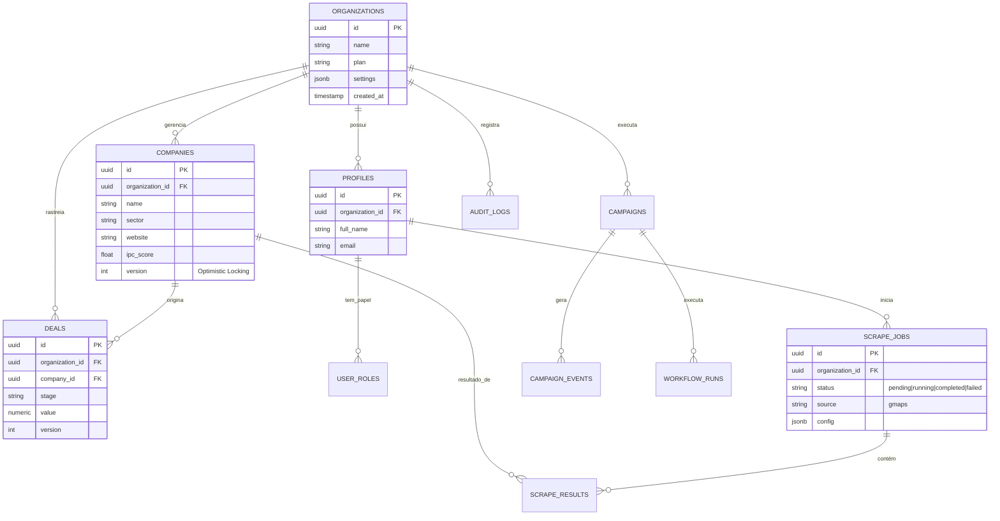

# 🗺️ Diagrama Entidade-Relacionamento (ERD)

Este diagrama representa a arquitetura de dados multi-tenant do LUX IA.

## Descrição das Tabelas Principais

- **organizations**: Unidade raiz de isolamento (Tenant).
- **profiles**: Usuários vinculados a uma organização.
- **companies**: Leads/Empresas prospectadas ou importadas.
- **scrape_jobs**: Registros de processos de raspagem (Google Maps, etc).
- **deals**: Oportunidades no funil de vendas (CRM).
- **audit_logs**: Trilha de auditoria imutável por organização.

---
*Gerado automaticamente via documentação técnica.*
